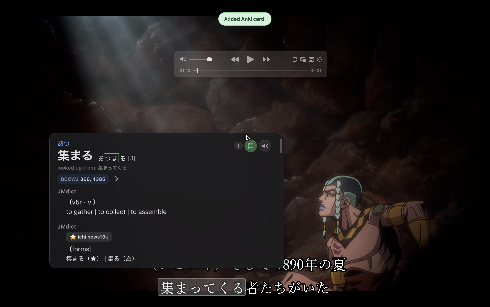
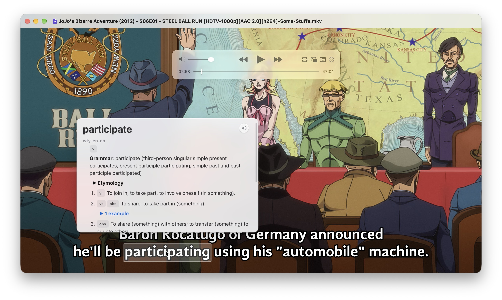
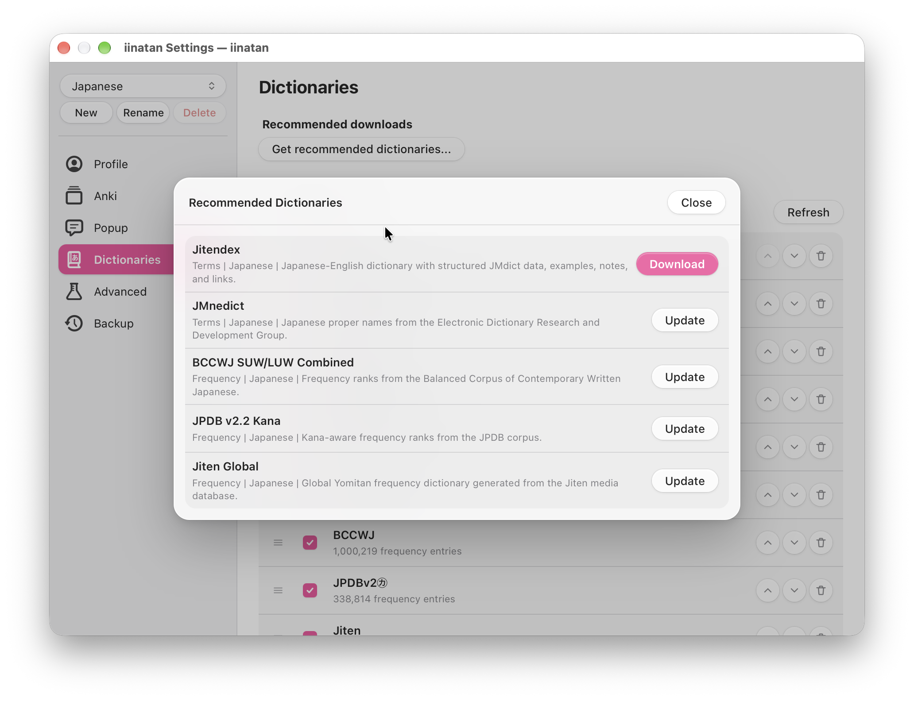
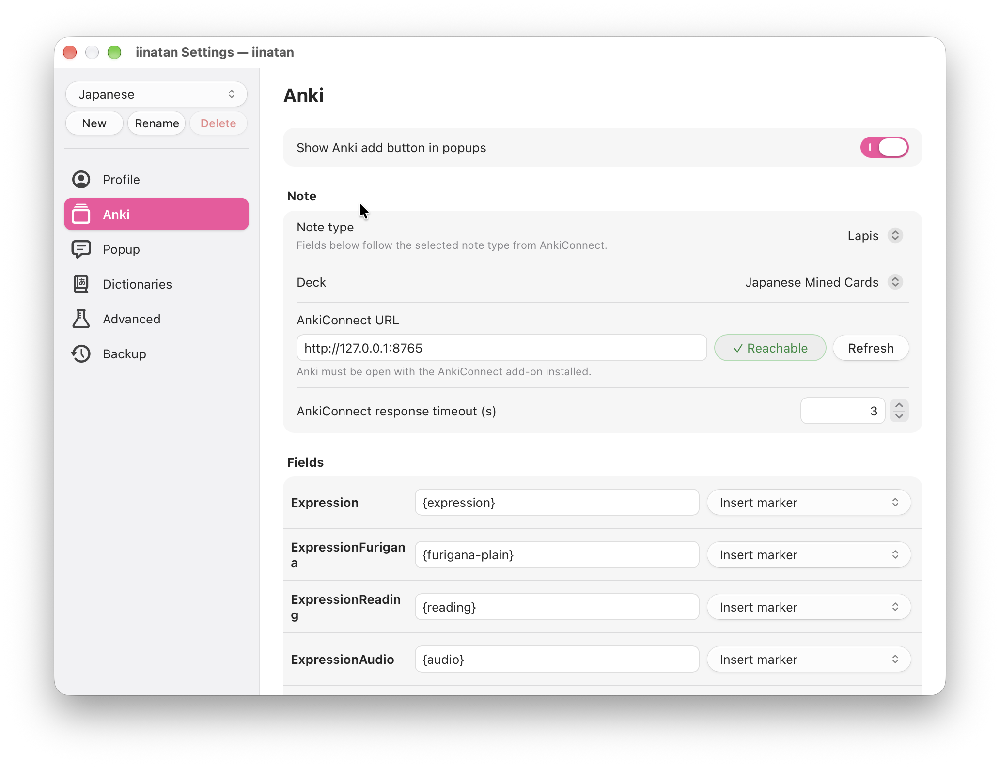
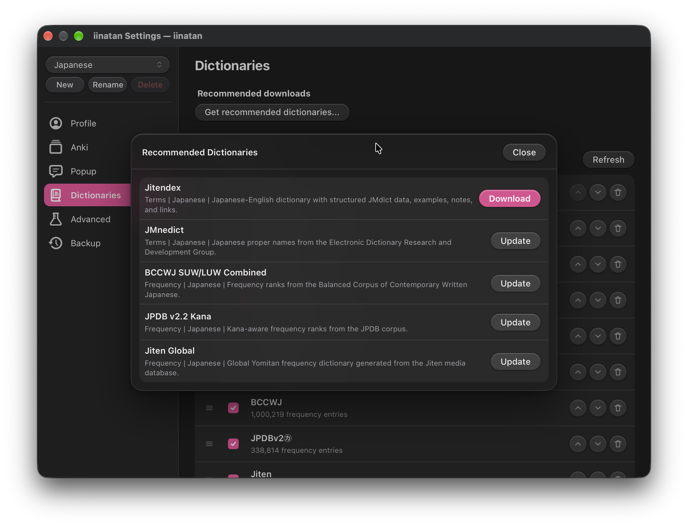

# iinatan

**Hover a subtitle. Get the definition. Mine the card.**

Yomitan-style dictionary popups for [IINA](https://iina.io) on macOS.

[**Download**](https://github.com/afn478/iinatan/releases/latest) · [Quick start](#quick-start) · [Features](#features) · [Anki](#anki-mining) · [Customize](docs/custom-popup-css.md)

## Why iinatan?

Watching shows in your target language works best when looking a word up takes no effort. iinatan lets you do it inside IINA: hover a word, the video pauses, a popup shows the definition, and one click turns that line into an Anki card with the sentence, a screenshot and the audio. When you move away, playback resumes.

## Features

|     |     |
| --- | --- |
| 🔍 **Instant lookups** | Hover or Shift-hover subtitle text. Playback pauses and then resumes on its own. |
| 🌏 **Six languages** | Japanese, English, French, German, Chinese, and Korean (experimental). |
| 📚 **Yomitan dictionaries** | Import any Yomitan-compatible ZIP, or install the recommended ones with one click. |
| 🎌 **Built for Japanese** | Deinflection, pitch accent, furigana, and frequency ranks (JPDB, BCCWJ, Jiten). |
| 🃏 **One-click Anki cards** | Sentence, screenshot, sentence audio, and word audio, with duplicate detection. |
| 🎞️ **Any subtitle** | SRT, ASS/SSA, and on-device OCR for bitmap subtitles such as Blu-ray PGS. |
| 🎨 **Native look** | Liquid Glass popups that follow light/dark mode, plus custom CSS for everything. |
| 🎮 **Controller support** | Look up words, browse popups, and add cards from the couch. [Mapping →](docs/dualsense-controls.md) |
| 👤 **Profiles** | Separate dictionaries, popup, and Anki settings for each language. |

## A closer look

<table>
<tr>
<td width="50%">
<picture>
  <source media="(prefers-color-scheme: dark)" srcset="docs/screenshots/popup-english-dark.jpg">
  
</picture>

<b>Rich entries:</b> tags, examples, and collapsible etymology

</td>
<td width="50%">
<picture>
  <source media="(prefers-color-scheme: dark)" srcset="docs/screenshots/recommended-dark.png">
  
</picture>

<b>One-click dictionaries:</b> download and update in the app

</td>
</tr>
<tr>
<td width="50%">
<picture>
  <source media="(prefers-color-scheme: dark)" srcset="docs/screenshots/anki-dark.png">
  
</picture>

<b>Anki mining:</b> map fields with Yomitan-style markers

</td>
<td width="50%">
<picture>
  <source media="(prefers-color-scheme: dark)" srcset="docs/screenshots/dictionaries-dark.png">
  
</picture>

<b>Your stack, your order:</b> enable and reorder dictionaries per profile

</td>
</tr>
</table>

## Quick start

1. **Install:** download [`iinatan.iinaplgz`](https://github.com/afn478/iinatan/releases/latest) and open it with IINA.
2. **Set up:** open **Plugins → iinatan → Settings…**, pick a language in the profile menu, and go to **Dictionaries**.
3. **Get dictionaries:** click **Get recommended dictionaries…**, or **Import ZIP…** your own Yomitan dictionaries.
4. **Watch:** play a subtitled video and hover a word.

> [!TIP]
> No popup? Press **Shift+H** to turn iinatan on or off.

<b>Install from GitHub (bleeding edge)</b>

 

In IINA's plugin manager choose **Install from GitHub** and enter `afn478/iinatan`. This tracks the latest commits, so it may sometimes break. Most users should use the release package.

## Anki mining

1. Install [AnkiConnect](https://ankiweb.net/shared/info/2055492159) and keep Anki open.
2. In the **Anki** tab, check that AnkiConnect shows **✓ Reachable**, then choose a deck and note type.
3. Map each field with markers such as `{expression}`, `{reading}`, `{furigana-plain}`, or `{audio}`.
4. Turn on **Show Anki add button in popups**, then press **+** in any popup.

Each profile keeps its own Anki settings: the deck, the note type, the duplicate behavior, the screenshot quality, and the sentence audio format.

## Subtitle support

- **Text subtitles** such as SRT work as-is.
- **ASS/SSA** keeps mpv's own rendering. iinatan places invisible hit boxes over the styled text. Very complex sign cues may be skipped.
- **Bitmap subtitles** (PGS and similar) go through Apple Vision OCR on your Mac. OCR can misread stylized or low-resolution text, and you can turn it off in Settings.

## Make it yours

The popup is plain HTML and CSS. The [custom popup CSS guide](docs/custom-popup-css.md) has ready-to-paste recipes for fonts, sizes, spacing, colors, Jitendex sections, and buttons.

## Troubleshooting

- **No popup:** press **Shift+H** to turn iinatan on, then hover again.
- **No results:** make sure the dictionary is enabled and that the profile language matches it.
- **Plugin stalls:** restart IINA.

## Contributing

Build, test, packaging, and release steps are in [CONTRIBUTING.md](CONTRIBUTING.md). To change the popup UI without starting IINA, open [`dev/popup-preview.html`](dev/popup-preview.html) in a browser. It renders real dictionary entries from the production overlay code (`npm run preview:data` refreshes them).

## Thanks

- [Yomipv](https://github.com/BrenoAqua/Yomipv) for the original idea of Yomitan-style lookup in mpv.
- [Yomitan](https://github.com/yomidevs/yomitan) for the popup dictionary experience that inspired iinatan.
- [HoshiDicts](https://github.com/Manhhao/hoshidicts/) for the dictionary engine behind iinatan.
- [Chimahon](https://github.com/sohilsayed/chimahon) and [Hoshi Reader Android](https://github.com/HuangAntimony/Hoshi-Reader-Android) for compact, reader-friendly lookup design.

## License

[GPL-3.0-only](LICENSE)
